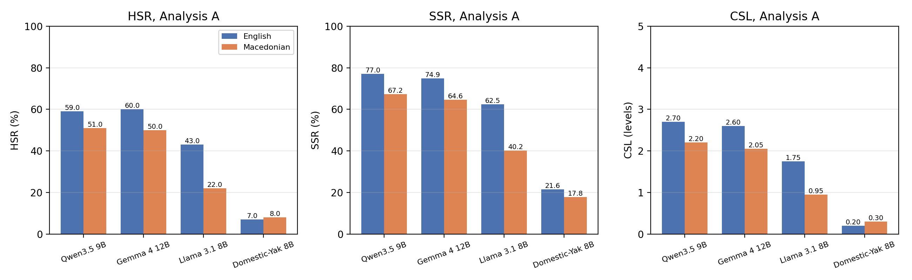
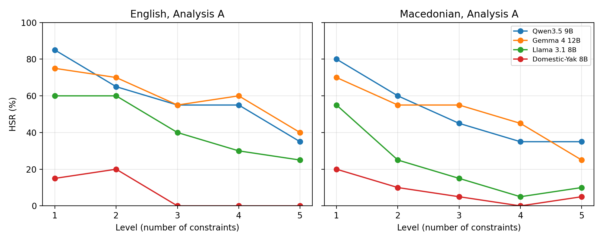
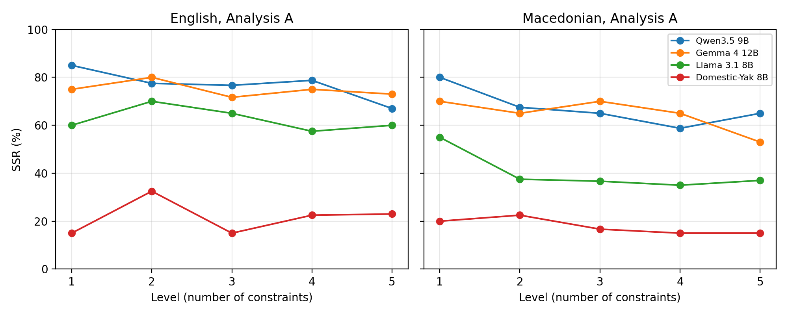
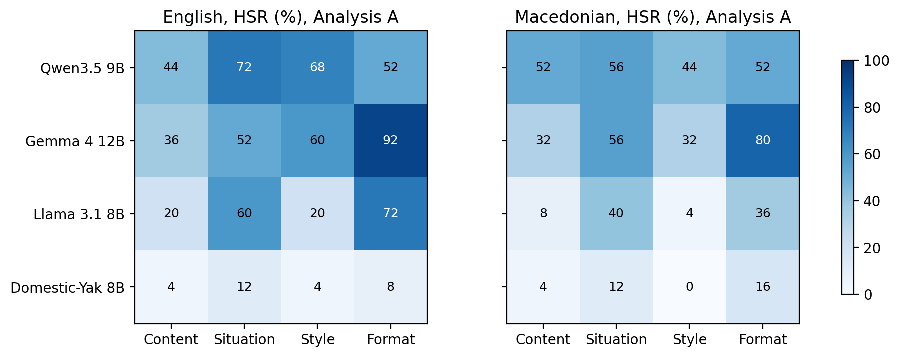
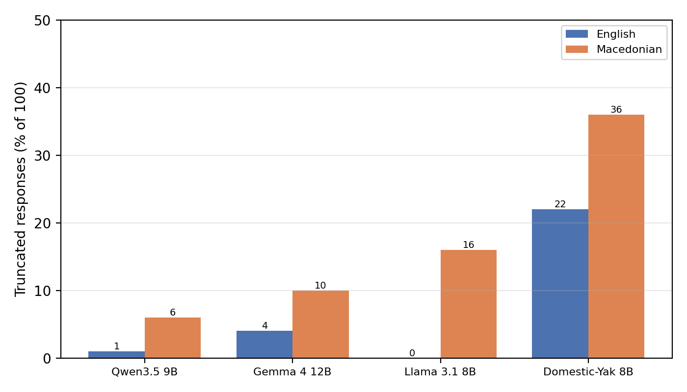
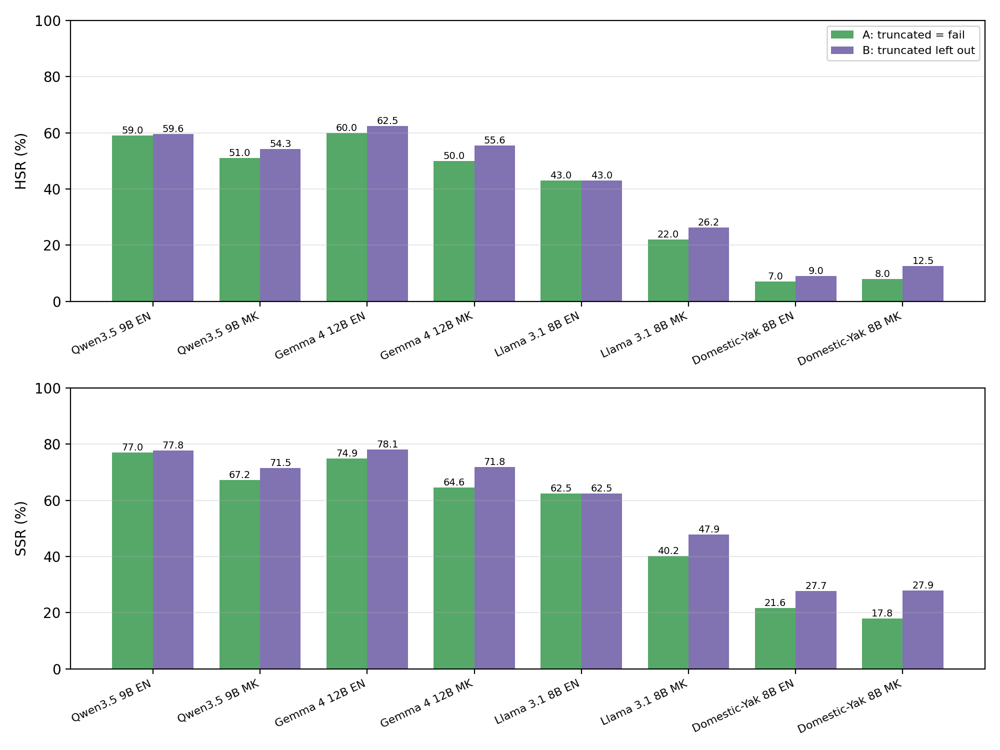

# FollowBench-MK results

All tables and figures from the paper, generated by `scripts/make_tables.py` and `scripts/make_figures.py`. HSR and SSR are in %, CSL in levels (0–5). Analysis A counts truncated responses as failures; Analysis B leaves them out.

## Main results (Table 6)

| Model | Lang | Judged | HSR (%) | HSR 95% CI | SSR (%) | CSL |
|---|---|---|---|---|---|---|
| Qwen3.5 9B | EN | 99 | 59.0 | [49.2, 68.1] | 77.0 | 2.70 |
| Qwen3.5 9B | MK | 94 | 51.0 | [41.3, 60.6] | 67.2 | 2.20 |
| Gemma 4 12B | EN | 96 | 60.0 | [50.2, 69.1] | 74.9 | 2.60 |
| Gemma 4 12B | MK | 90 | 50.0 | [40.4, 59.6] | 64.6 | 2.05 |
| Llama 3.1 8B | EN | 100 | 43.0 | [33.7, 52.8] | 62.5 | 1.75 |
| Llama 3.1 8B | MK | 84 | 22.0 | [15.0, 31.1] | 40.2 | 0.95 |
| Domestic-Yak 8B | EN | 78 | 7.0 | [3.4, 13.7] | 21.6 | 0.20 |
| Domestic-Yak 8B | MK | 64 | 8.0 | [4.1, 15.0] | 17.8 | 0.30 |

## Paired English–Macedonian outcomes (Table 7)

Each model has 100 prompt pairs; "satisfied" means all constraints were satisfied.

| Model | Both | Only EN | Only MK | Neither |
|---|---|---|---|---|
| Qwen3.5 9B | 43 | 16 | 8 | 33 |
| Gemma 4 12B | 44 | 16 | 6 | 34 |
| Llama 3.1 8B | 21 | 22 | 1 | 56 |
| Domestic-Yak 8B | 1 | 6 | 7 | 86 |
| Total | 109 | 60 | 22 | 209 |

## Results by level (Table 8)

HSR (%) by level and CSL, Analysis A, n = 20 per level.

| Model | Lang | L1 | L2 | L3 | L4 | L5 | Avg | CSL |
|---|---|---|---|---|---|---|---|---|
| Qwen3.5 9B | EN | 85.0 | 65.0 | 55.0 | 55.0 | 35.0 | 59.0 | 2.70 |
| Qwen3.5 9B | MK | 80.0 | 60.0 | 45.0 | 35.0 | 35.0 | 51.0 | 2.20 |
| Gemma 4 12B | EN | 75.0 | 70.0 | 55.0 | 60.0 | 40.0 | 60.0 | 2.60 |
| Gemma 4 12B | MK | 70.0 | 55.0 | 55.0 | 45.0 | 25.0 | 50.0 | 2.05 |
| Llama 3.1 8B | EN | 60.0 | 60.0 | 40.0 | 30.0 | 25.0 | 43.0 | 1.75 |
| Llama 3.1 8B | MK | 55.0 | 25.0 | 15.0 | 5.0 | 10.0 | 22.0 | 0.95 |
| Domestic-Yak 8B | EN | 15.0 | 20.0 | 0.0 | 0.0 | 0.0 | 7.0 | 0.20 |
| Domestic-Yak 8B | MK | 20.0 | 10.0 | 5.0 | 0.0 | 5.0 | 8.0 | 0.30 |

## SSR by level (Figure 5)

| Model | Lang | L1 | L2 | L3 | L4 | L5 | Avg |
|---|---|---|---|---|---|---|---|
| Qwen3.5 9B | EN | 85.0 | 77.5 | 76.7 | 78.8 | 67.0 | 77.0 |
| Qwen3.5 9B | MK | 80.0 | 67.5 | 65.0 | 58.8 | 65.0 | 67.2 |
| Gemma 4 12B | EN | 75.0 | 80.0 | 71.7 | 75.0 | 73.0 | 74.9 |
| Gemma 4 12B | MK | 70.0 | 65.0 | 70.0 | 65.0 | 53.0 | 64.6 |
| Llama 3.1 8B | EN | 60.0 | 70.0 | 65.0 | 57.5 | 60.0 | 62.5 |
| Llama 3.1 8B | MK | 55.0 | 37.5 | 36.7 | 35.0 | 37.0 | 40.2 |
| Domestic-Yak 8B | EN | 15.0 | 32.5 | 15.0 | 22.5 | 23.0 | 21.6 |
| Domestic-Yak 8B | MK | 20.0 | 22.5 | 16.7 | 15.0 | 15.0 | 17.8 |

## Failure consistency (Table 9)

Share of failed levels L1–L4 after which every later level of the same family also failed.

| Model | English | Macedonian |
|---|---|---|
| Qwen3.5 9B | 78.6% (22/28) | 75.0% (27/36) |
| Gemma 4 12B | 82.1% (23/28) | 77.1% (27/35) |
| Llama 3.1 8B | 90.5% (38/42) | 91.7% (55/60) |
| Domestic-Yak 8B | 95.9% (70/73) | 93.2% (68/73) |

## Results by category (Figure 4)

HSR (%) per category, 25 prompts per cell. A: truncated = fail. B: truncated left out.

| Model | Lang | HSR content A | HSR situation A | HSR style A | HSR format A | HSR content B | HSR situation B | HSR style B | HSR format B |
|---|---|---|---|---|---|---|---|---|---|
| Qwen3.5 9B | EN | 44.0 | 72.0 | 68.0 | 52.0 | 45.8 | 72.0 | 68.0 | 52.0 |
| Qwen3.5 9B | MK | 52.0 | 56.0 | 44.0 | 52.0 | 56.5 | 63.6 | 45.8 | 52.0 |
| Gemma 4 12B | EN | 36.0 | 52.0 | 60.0 | 92.0 | 39.1 | 56.5 | 60.0 | 92.0 |
| Gemma 4 12B | MK | 32.0 | 56.0 | 32.0 | 80.0 | 36.4 | 63.6 | 36.4 | 83.3 |
| Llama 3.1 8B | EN | 20.0 | 60.0 | 20.0 | 72.0 | 20.0 | 60.0 | 20.0 | 72.0 |
| Llama 3.1 8B | MK | 8.0 | 40.0 | 4.0 | 36.0 | 9.5 | 43.5 | 6.7 | 36.0 |
| Domestic-Yak 8B | EN | 4.0 | 12.0 | 4.0 | 8.0 | 4.8 | 12.0 | 7.1 | 11.1 |
| Domestic-Yak 8B | MK | 4.0 | 12.0 | 0.0 | 16.0 | 5.6 | 20.0 | 0.0 | 20.0 |

## Truncated responses (Figure 1)

Responses that reached the 2,048-token limit, out of 100 per model and language.

| Model | English | Macedonian |
|---|---|---|
| Qwen3.5 9B | 1 | 6 |
| Gemma 4 12B | 4 | 10 |
| Llama 3.1 8B | 0 | 16 |
| Domestic-Yak 8B | 22 | 36 |
| Total | 27 | 68 |

By level, over all models:

| Lang | L1 | L2 | L3 | L4 | L5 |
|---|---|---|---|---|---|
| EN | 3 | 4 | 6 | 9 | 5 |
| MK | 11 | 10 | 12 | 18 | 17 |

## Judge agreement (Table 5)

Agreement between the two judges on whether a response satisfied all of its criteria.

| Group | Judged responses | Same verdict | Agreement |
|---|---|---|---|
| English | 373 | 333 | 89.3% |
| Macedonian | 332 | 297 | 89.5% |
| All | 705 | 630 | 89.4% |

## Robustness checks (Table 10)

HSR (%) English / Macedonian. The first three columns use Analysis A; "ChatGPT only" and "Claude only" use one judge's decisions for every criterion.

| Model | Final | ChatGPT only | Claude only | Analysis B |
|---|---|---|---|---|
| Qwen3.5 9B | 59.0 / 51.0 | 61.0 / 53.0 | 58.0 / 45.0 | 59.6 / 54.3 |
| Gemma 4 12B | 60.0 / 50.0 | 67.0 / 49.0 | 63.0 / 48.0 | 62.5 / 55.6 |
| Llama 3.1 8B | 43.0 / 22.0 | 46.0 / 24.0 | 41.0 / 23.0 | 43.0 / 26.2 |
| Domestic-Yak 8B | 7.0 / 8.0 | 8.0 / 10.0 | 8.0 / 9.0 | 9.0 / 12.5 |

## Analysis B: truncated responses left out (Table 12)

\* fewer than 10 families.

| Model | Lang | Judged | HSR (%) | SSR (%) | CSL (families) |
|---|---|---|---|---|---|
| Qwen3.5 9B | EN | 99 | 59.6 | 77.8 | 2.84 (19) |
| Qwen3.5 9B | MK | 94 | 54.3 | 71.5 | 2.35 (17) |
| Gemma 4 12B | EN | 96 | 62.5 | 78.1 | 2.89 (18) |
| Gemma 4 12B | MK | 90 | 55.6 | 71.8 | 2.54 (13) |
| Llama 3.1 8B | EN | 100 | 43.0 | 62.5 | 1.75 (20) |
| Llama 3.1 8B | MK | 84 | 26.2 | 47.9 | 1.50 (12) |
| Domestic-Yak 8B | EN | 78 | 9.0 | 27.7 | 0.38 (8)* |
| Domestic-Yak 8B | MK | 64 | 12.5 | 27.9 | 0.50 (6)* |

